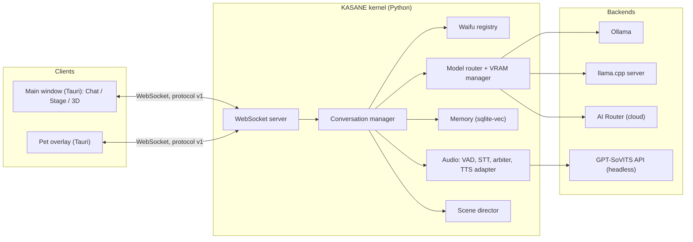
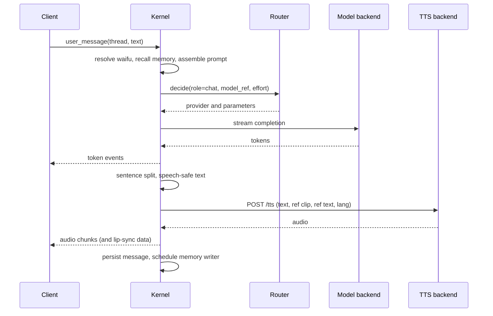
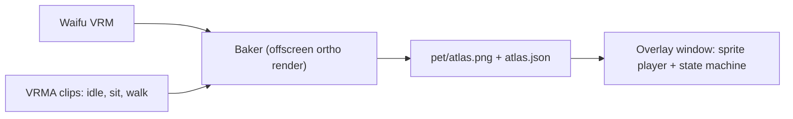

# ARCHITECTURE — Kōkyū

How the system is built. Requirements are in `SPEC.md`; rationale for choices is in `DECISIONS.md`. Where this document says **(draft)**, K0 must reconcile it with the real Yuri code before it is relied on.

## 1. Overview

One **kernel** (KASANE, Python) holds all logic and state. **Clients** (Tauri windows) render and send input. Heavy things (LLM runtimes, TTS) are **backends** the kernel talks to over HTTP. A waifu is *data* the kernel loads; no component contains waifu-specific code.



### Design principles

1. **Waifu = data.** Registry loads packs; the only waifu-dependent values are prompt text, TTS parameters, VRM and pet atlas (FR-W-3).
2. **Thin clients.** State lives in the kernel; clients subscribe to events and send intents. A browser tab, the Tauri window and the pet overlay are the same protocol.
3. **One door for models.** `router.decide()` (FR-R-1).
4. **VRAM is the scarce resource.** A manager owns what is loaded and refuses combinations that do not fit.
5. **Packaging-ready.** All paths from one module; no dev-only assumptions at runtime (RULES §9).

## 2. Processes and lifecycle

| Process | Owner | Started | Notes |
|---|---|---|---|
| Tauri main window | user | on launch | Chat, Stage, 3D views (K0 keeps Yuri's small widget window; K1 builds the new one) |
| Pet overlay window | Tauri | when a pet is brought out | One per monitor (D-014) |
| Kernel (`KASANE/`, Python) | **Tauri** (child, Windows Job Object) | at launch, **in parallel with the TTS backend** | `127.0.0.1:8780` (D-027) |
| TTS backend (GPT-SoVITS API) | **Tauri** (child) | at launch, in parallel | Folder configured once (`launcher.local.txt`, later Settings); outside this repo; default port 9880 |
| `llama-server` | kernel (child) | when a llama.cpp model is selected | Unloaded before an Ollama large model loads |
| Ollama | external service | by the user | The kernel only talks HTTP to it |

**Startup (carried from Yuri, D-027):** Tauri starts the kernel and the TTS backend at the same time and waits for their ports; it sets `KOKYU_SHELL_STARTS_TTS=1` so the kernel never launches TTS itself. Run by hand without the shell, the kernel launches TTS itself, as Yuri's `tts.ensure_server()` does. Stale listeners on the two ports are cleared first. Models load on first use.

**Shutdown:** tray Quit → `POST /shutdown` to the kernel → memory consolidation → kernel stops its children → hard kill after about 5 s. The Job Object (kill-on-close) guarantees no orphans if Tauri is killed.

**Health:** the kernel will expose a health endpoint (new) and publish `status` events that feed the Doctor panel (FR-SET-3).

## 3. Repository layout (target)

The kernel keeps Yuri's **flat module layout**: the `KASANE/` folder is put on `sys.path` and modules import each other by top-level name (`import llm`, `from audio import tts`). There is no importable `kasane` package (D-024).

```
KASANE/
  app.py  bus.py  config.py  llm.py  settings.py  check.py  context_budget.py   (from Yuri)
  paths.py               DONE (K0): ALL filesystem locations
  waifus/                DONE (K0): pack model, loader, validator, registry (instruction template comes in K3)
  prompting.py           DONE (K0): persona prompt + shared app addendum
  threads/               NEW (K1): SQLite thread store
  conversation.py        NEW (K1): turn loop extracted from ws_endpoint
  protocol/              NEW (K1): typed message models
  router/                from Yuri; K1 adds the `chat` role and the egress policy (D-025)
  models/                NEW (K1): backend lifecycle, VRAM manager, capability registry
  memory/                from Yuri; K0 adds the speaker
  audio/                 from Yuri; tts.py takes per-waifu voice parameters (K0-11)
  senses/  tools/        from Yuri (Task Guide and OCR watch parked, D-029)
  scenes/                NEW (K5): scene pack loader and director
  tests/  conftest.py
src/
  (K0) Yuri's engine and widget UI as seeded
  (K1+) app/ React chrome · engine/ imperative three.js · net/ typed WebSocket client
src-tauri/               windows, tray, hotkeys, child processes, overlay hit-testing
config/                  config.example.yaml, models.example.yaml, secrets.example.yaml
scripts/                 dev.mjs, doctor.mjs, check.mjs (new), seed_waifus.py (new), packaging
tests-fe/
docs/
```

## 4. Kernel modules

| Module | Responsibility | Key invariants |
|---|---|---|
| `waifus/` | Parse/validate packs, hot-reload, expose `Waifu` objects | Pure data; no behaviour flags |
| `conversation.py` | Owns turns: resolve active waifu → recall memory → assemble prompt → call router → stream → speech pipeline → persist | Same code path for every waifu |
| `router/` | Role-based decisions, providers, spend, audit, redaction | Local-only roles refused for cloud before a provider is chosen |
| `models/` | Backend lifecycle (Ollama keep-alive, llama-server spawn), VRAM manager, capability registry | Only one big model resident at a time across backends |
| `memory/` | Facts and episodes with supersede and decay | Not namespaced by waifu; writes name the speaker |
| `audio/` | VAD, STT, TTS adapter, arbiter, speech-safe text | One voice at a time |
| `scenes/` | Load scene packs, place waifus, drive waypoints and gaze data | Produces *commands*; clients animate |

### 4.1 Prompt assembly

Yuri's real shape (`docs/notes/yuri-inventory.md` §5): `history[0]` is the system prompt (inferred), and one **ephemeral system message** (forget/task/look hints, recalled memory, scene context) is spliced just before the last user message and is never stored in history.

```
system    =  persona prompt (the speaking waifu's prompt.md)
          +  APP ADDENDUM  (identical for every waifu)
history   =  prior messages (speaker-tagged; other waifus' lines appear as context)
ephemeral =  recall + hints + scene context   (spliced before the last user message, as in Yuri)
user      =  current message (+ attachments)
```

The **app addendum** is the same for all waifus and carries: speech rules, the **emotion-tag convention** (the reply ends with `[happy|angry|sad|teasing|surprised|neutral]`, extracted by the existing helper), date and time, a no-capability-claims line, and the existing generic output cleanup (`apply_persona_pass`). Only the first line differs between waifus. The invariance test (FR-W-3) diffs everything *except* the persona prompt and TTS parameters.

### 4.2 Turn lifecycle



## 5. Protocol

WebSocket at `ws://127.0.0.1:8780/ws` (Yuri used 8765). Today it is **untyped JSON dicts with no version field** (`docs/notes/yuri-inventory.md` §4). Existing names are kept; nothing is renamed for its own sake.

### 5.1 Existing messages (kept)

| Direction | Types |
|---|---|
| Client → kernel | `user_text`, `user_file`, `user_audio`, `audio_frame`, `audio_end`, `stop`, `set_temp_mode`, `set_ocr_watch`, `set_api_model`, `get_log`, `clear_log`, `camera_frame`, `scene_state` |
| Kernel → client | `speak` (`text`, `audio_b64`, `mime`; one per clause), `turn_end`, `transcript`, `speech_state`, `surface_status`, `settings`, `log`, `barge_in`, `request_camera_frame` |

There are **no token events** and no thread, waifu or model concept.

### 5.2 Added in K0

| Direction | Type | Purpose |
|---|---|---|
| Client → kernel | `switch_waifu` `{id}` | Change the active waifu for subsequent turns |
| Kernel → client | `waifu_state` `{active, waifus:[{id, name, premade, traits}], problems:[text], pending?}` | Roster and active waifu; sent on connect and after every switch. `active` is null when no pack is installed; `pending` names a switch waiting for the running turn |
| Kernel → client | `error` `{code:"unknown_waifu", message}` | A switch named a companion that does not exist |
| Kernel → client | `speak` with `audio_b64: ""` | Voice backend down: caption only, no audio (FR-V-7) |
| HTTP | `GET /waifus/{id}/vrm` | A registered waifu's avatar (CORS: loopback page origins, GET only) |

### 5.3 Target (K1): typed protocol

Pydantic models in `KASANE/protocol/`, mirrored in `src/net/`; frames `{ "v": 1, "type", "id", "thread", "data" }`; a version mismatch is a hard, visible error. Additions beyond 5.1/5.2:

| Direction | Type | Purpose |
|---|---|---|
| C→K | `hello` | Client identity (main, pet), protocol version |
| C→K | `set_model`, `set_effort` | Per-thread selection |
| C→K | `attach` | Register an uploaded file or camera frame |
| C→K | `scene_enter`, `scene_set`, `scene_leave`, `scene_input` | 3D mode (K5) |
| C→K | `pet_spawn`, `pet_dismiss`, `pet_click` | Pets (K4) |
| C→K | `waifu_create`, `waifu_delete`, `waifu_validate_*` | Creator (K3) |
| K→C | `state` | Thread, waifu, model, effort, voice-status snapshot |
| K→C | `turn_start`, `token` | Streaming (FR-C-2) |
| K→C | `captions`, `expression`, `look_at` | Avatar hints |
| K→C | `model_loading`, `vram`, `spend` | Model chip and meters |
| K→C | `error` | Typed errors (quota, auth, vram, tts_down, …) |
| K→C | `scene_state` | Positions, anchors, who is speaking |
| K→C | `doctor` | Health report |

Binary frames carry audio when `speak` is replaced by chunked audio (K2).

## 6. Data and storage

### 6.1 App-data layout (via `paths.py`)

Dev: `./data`. Packaged: `%APPDATA%\Kokyu`.

```
data/
  settings.json
  threads.db            threads, messages, attachments
  memory.db             Yuri memory v2 schema
  waifus/<id>/          waifu.yaml, prompt.md, model.vrm, voice/ref.wav, pet/
  scenes/<id>/          user-added scenes (built-in scenes ship with the app)
  attachments/
  logs/                 kernel.log, tts.log, audit.jsonl, latency.jsonl
  cache/                model catalog, thumbnails
  spend.db
```

### 6.2 Config layering

`defaults (code)` → `config/config.yaml` (dev) → environment (`KOKYU_*`, `.env`) → `settings.json` (user changes in the UI). Later layers win. Secrets come only from `.env` or `config/secrets.local.yaml`.

### 6.3 Writes

Atomic (temp file then rename) for settings and packs; SQLite in WAL mode; waifu pack creation is staged in a temp directory and moved into place only when valid.

## 7. Model routing and the VRAM manager

### 7.1 Roles

Yuri's roles are kept (`docs/notes/yuri-inventory.md` §6): `reflex`, `vision`, `classifier`, `embed` and `memory_writer` are `local_only` (a startup invariant); `mind` is the only cloud-eligible role and nothing calls it yet. Kōkyū adds a **`chat`** role in K1 that runs on the thread's user-selected `model_ref`, local or API; the selection is the consent (D-025). Until K1, chat turns keep using `reflex`.

| Role | Used for | Where it may run |
|---|---|---|
| `chat` (K1) | The user-selected model for the thread | local or API |
| `reflex` | Yuri's current chat role (until K1) | local only |
| `mind` | Yuri's cloud-eligible role; unused until agent mode | local or API |
| `classifier` | Speaker choice (two-waifu scenes), look-intent | local only |
| `memory_writer` | Distilling facts and episodes | local only |
| `embed` | Memory recall (`nomic-embed-text`) | local only |
| `vision` | Camera and image attach | local by default; API only for images the user explicitly attached (D-025) |

### 7.2 Capability registry

`config/models.yaml` (plus catalog flags for API models) declares per model: supported effort levels and mapping, context size, vision support, and an optional VRAM estimate override. This is how the effort slider knows its detents (FR-M-10).

### 7.3 VRAM manager

- Reads total/free VRAM through NVML (`nvidia-ml-py`).
- Estimates a model's footprint as file size plus KV cache plus a safety margin; **measured** values observed after load replace the estimate and are cached.
- Tracks residents: chat model, embeddings, TTS backend, renderer allowance.
- Rule: only **one large LLM** resident across Ollama and llama.cpp. Selecting a model on the other backend unloads the first (`keep_alive: 0` for Ollama; stop `llama-server`) before loading.
- Produces *fits / won't fit* hints for the switcher and refuses a load that would exceed free VRAM minus headroom, naming the blocker.
- Large MoE on llama.cpp (for example Qwen3.5-35B-A3B Q4) uses expert offload to CPU; its VRAM and RAM use are measured in a dedicated spike (K1).

### 7.4 Providers

`ollama` (native API), `llamacpp` (OpenAI-compatible) and a generic **`openai_compat`** provider (configurable base URL and key; AI Router, OpenRouter, DeepSeek and others are presets; Yuri's `airouter` provider is the starting point, D-037). The provider is chosen only by `decide()`. User-selected API failures are surfaced, never rerouted (FR-R-5). **Known gap:** Yuri's `OllamaNativeProvider.complete` ignores its `model` argument and uses the global `llm.CONFIG.llm.model`; K1 changes `llm.py` to take a model and an effort setting.

## 8. Voice pipeline

```
mic frames → VAD (energy) → STT (faster-whisper, CPU) → transcript → user_message
model tokens → sentence splitter → speech-safe normalizer → TTS adapter → audio chunks → arbiter → client playback → lip-sync
```

- **Voice providers** share one interface, `synthesize(text, voice) → audio` (D-036): `gpt_sovits`, `builtin` (small local voices; chosen in a K2 spike) and `elevenlabs` (hosted, opt-in, badged as cloud). The **`gpt_sovits` adapter** (`audio/tts.py`) speaks only the contract in `TTS-BACKEND.md`. Per request: `text`, `text_lang`, `ref_audio_path`, `prompt_text`, `prompt_lang`. It sends a **pre-warm** on waifu select. If the backend is down it raises a typed error; the conversation continues text-only.
- **Arbiter** owns the single audio output: states `idle`, `speaking`, `cancelling`. A new user speech event while `speaking` triggers barge-in: cancel generation, drop queued lines, send `stop_playback`.
- **Lip-sync** is computed on the client from the audio being played (amplitude to `aa`), so it stays in sync with real playback.
- STT stays on **CPU** by default (VRAM budget, and the known CUDA DLL issue on this machine).

## 9. Clients

### 9.1 Main window

Yuri's current UI is a **stage-first widget** (340×480 borderless, transparent, always-on-top window; avatar canvas, caption, input, mic, quick-action menu, log panel; inventory §11–12). K0 keeps it untouched apart from a temporary waifu dropdown. The sidebar, Chat view and normal app window arrive in K1; the stage code becomes the Stage view in K2.

React renders chrome: sidebar, thread view, input row, popovers, settings, creator. A **store** (default Zustand, D-013) is fed by WebSocket events. The **engine** (`src/engine/`) is an imperative three.js module mounted into a canvas ref; React never drives per-frame state.

Views of one thread: **Chat**, **Stage**, **3D**. All three read the same store.

### 9.2 Engine (shared by stage, pets baker and 3D)

- Avatar loader: `GLTFLoader` + `VRMLoaderPlugin`, `VRMUtils.rotateVRM0()`, bone and expression discovery, spring bones.
- Stage: auto-framing from head/chest bones, backdrop, idle motion, lip-sync, look-at.
- Scene runtime: scene pack loader, WASD controller with pointer lock, colliders, waifu placement from `scene_state`.
- XR-compatible renderer setup (no XR code in v1).

### 9.3 Pets



- **Baker** runs in the main window's engine on waifu save (and on demand), writing the atlas to `pet/`.
- **Overlay** is one transparent always-on-top window per monitor hosting all pets on a canvas. Rust handles window flags and **alpha hit-testing**: it toggles cursor pass-through depending on whether the pointer is over an opaque sprite pixel (the overlay reports hit-test data; Rust applies `ignore cursor events`). K4 starts with a spike to validate this against one-window-per-pet.
- Sprites animate at 12 to 24 fps; no 3D at runtime.

### 9.4 3D scenes

Scene pack (`scene.glb` + `scene.yaml`) loaded by the engine. The kernel's **scene director** decides where each waifu is, which anchor she uses and her waypoints, and emits `scene_state`; the client animates with the shared avatar code. Collision is simple boxes from `colliders`. The user's controller is client-side; position is reported to the kernel so waifus can face and approach.

## 10. Security and trust

- Kernel binds to loopback; Tauri CSP forbids remote scripts.
- Bus events carry `trust` (`trusted` from the user, `untrusted` from files, OCR, web). Untrusted text is data, never an instruction source. This is groundwork for agent mode.
- Redaction (keys, paths, emails, long digit runs) applies before any cloud call and in the audit log.
- End-user keys live in the **Windows Credential Manager** (set through the app; the Rust shell passes them to the kernel at spawn). `.env` and `secrets.local.yaml` are developer-only; the repo carries `.example` files.

## 11. Packaging architecture (K7, designed now)

- **Installer:** Tauri bundler produces an NSIS installer (Yuri already sets the `nsis` target); the WebView2 bootstrapper is included. `security.csp` is currently `null` in the seeded config and must be locked down in K1.
- **Kernel sidecar:** the Python kernel is frozen (PyInstaller or an embedded Python) and registered as a Tauri sidecar; the Job Object logic is unchanged.
- **Not bundled:** model weights, Ollama, the GPT-SoVITS backend. A **first-run checklist** (the Doctor panel) detects each and links to instructions.
- **Portable bundle:** zip containing the app, `setup.ps1` (creates the Python environment if the sidecar is not frozen, verifies prerequisites, runs the Doctor) and a README with setup instructions.
- **Data:** `%APPDATA%\Kokyu` (FR-DIST-4). Built-in scenes and the instruction template ship as read-only resources.
- Design consequences already enforced: `paths.py`, no repo-relative assumptions, config layering, versioned protocol, bundled resources accessed through a resource resolver.

### 11.1 Packaging decisions for the K1b spike

1. **Kernel packaging.** (a) PyInstaller one-folder build shipped as app resources and launched by the shell, or (b) an embedded CPython with prebuilt site-packages. The user installs neither Python nor Node in either case. Choose by installer size, antivirus behaviour (unsigned PyInstaller executables are a known false-positive trigger) and updateability. Tauri's `externalBin` expects one executable, so a one-folder build needs resource bundling.
2. **Installer.** NSIS, per-user (no admin), with the WebView2 bootstrapper; MSI only if a channel needs it.
3. **Updater.** Tauri updater with its own signing key (separate from the code-signing certificate); a static update manifest.
4. **Code signing.** Research certificate options and eligibility; sign the installer and the kernel executable. Expect SmartScreen friction for a new publisher.
5. **License key.** A public key compiled into the app verifies a signed key offline; storage in app data (FR-DIST-10, depends on D-032).
6. **Diagnostics.** Export zip: redacted logs, versions, component states (FR-DIST-8).
7. **CI.** GitHub Actions on tagged releases builds the installer on a Windows runner; the clean-VM install test is manual until automated.

## 12. Testing architecture

| Layer | Tool | Notes |
|---|---|---|
| Kernel unit and integration | pytest | Fakes for models, TTS, STT; real SQLite for memory/threads |
| Invariance tests | pytest, parameterized over fixture waifus | FR-W-3 |
| Protocol contract | pytest + shared JSON fixtures also used by frontend tests | Prevents drift |
| Frontend | the runner Yuri uses (`npm run test:fe`) | Store reducers, components |
| Type/build | `tsc --noEmit`, `vite build`, `cargo check` | `npm run check` |
| Manual gates | checklists in `TODO.md` | Anything needing GPU, mic, display or VR |

No automated test may require a GPU, network, API key or display.

## 13. Performance budget (planning numbers, to be measured)

| Component | Approx. VRAM | Notes |
|---|---|---|
| Chat model `qwen3.5:9b` Q4 | ~6.6 GB | Q6_K_L (~9.4 GB) is opt-in |
| `qwen3.5:4b` | ~3.4 GB | "Lite" |
| Embeddings | ~0.3 GB | Always resident |
| GPT-SoVITS | ~2 to 3 GB (unmeasured) | Measure in track T |
| Renderer | ~0.5 to 1 GB (unmeasured) | Measure in K2 |
| Qwen3.5-35B-A3B Q4 (llama.cpp, experts on CPU) | small VRAM, ~20 GB system RAM | Spike in K1 |

## 14. Extension points for deferred features

- **Agent mode** adds a `tools/` package and a `read/write` tier system behind the existing router and bus; the thread gains a `mode` field; no waifu-facing changes. The `trust` flag already exists.
- **VR** adds an XR session to the engine's renderer and a client route served by the kernel; the protocol and scene runtime are unchanged.

## 15. Component manager and first-run

Every managed piece of infrastructure is a **component** with one interface, so the Doctor panel, the Welcome wizard and the repair buttons share the same code (FR-COMP, D-035).

| Component | Kind | How it is managed |
|---|---|---|
| Ollama | external service | Detect (port 11434, installed), install by running the official installer with the user's consent (silent mode to be tested), monitored only; model pulls through the Ollama API with progress |
| llama.cpp server | downloadable binary | Download a pinned release (CPU or CUDA variant chosen by the hardware check), verify our SHA-256, start on demand as a kernel child |
| GPT-SoVITS backend | downloadable package | Recipe from Track T (official Windows package or a scripted install), pinned version and hash, started by the shell as a child; advanced and hardware-gated |
| STT model | model files | faster-whisper downloads the chosen size on first use; the app shows progress |
| Built-in voice | model files | Small local voice model, chosen in K2 |
| Hosted providers | none | Key test only |

**Interface:** `detect() → {state, version, location}`, `install(progress)`, `start()`, `stop()`, `health() → {ok, code, message, fix}`, `repair()`. **States:** `missing`, `installing`, `stopped`, `starting`, `running`, `unhealthy`.

**Manifest:** `components/<id>.json` ships with the app: id, version, source URLs, SHA-256, size, install steps, start command, health URL, hardware requirements. Track T delivers the GPT-SoVITS one.

**Rules:** installs are user-initiated, resumable, cancellable, write only under the app-data directory and verify hashes; started components are Job Object children; externally managed ones are only monitored; every failure maps to a plain message with one primary action.

**Wizard:** a state machine persisted in `settings.json` (`onboarding.step`, `completed`); skippable steps; re-runnable from Settings; the API path finishes with nothing installed except the built-in voice. **Doctor:** the same component states as a panel.
