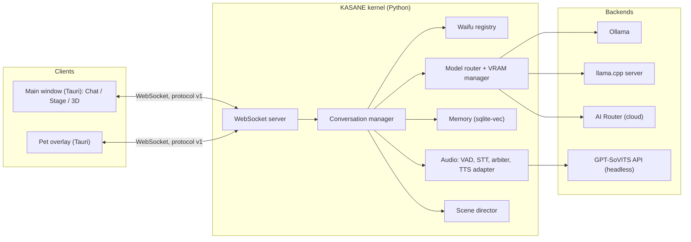
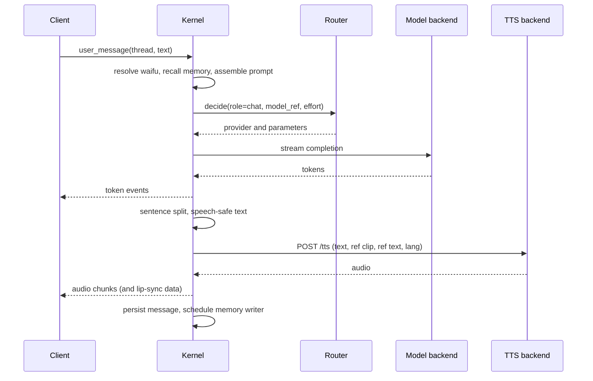
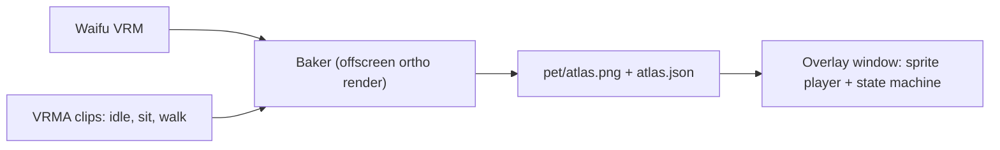

# ARCHITECTURE — Kōkyū

How the system is built. Requirements are in `SPEC.md`; rationale for choices is in `DECISIONS.md`. Where this document says **(draft)**, K0 must reconcile it with the real Yuri code before it is relied on.

## 1. Overview

One **kernel** (KASANE, Python) holds all logic and state. **Clients** (Tauri windows) render and send input. Heavy things (LLM runtimes, TTS) are **backends** the kernel talks to over HTTP. A waifu is *data* the kernel loads; no component contains waifu-specific code.



### Design principles

1. **Waifu = data.** Registry loads packs; the only waifu-dependent values are prompt text, TTS parameters, VRM and pet atlas (FR-W-3).
2. **Thin clients.** State lives in the kernel; clients subscribe to events and send intents. A browser tab, the Tauri window and the pet overlay are the same protocol.
3. **One door for models.** `router.decide()` (FR-R-1).
4. **VRAM is the scarce resource.** A manager owns what is loaded and refuses combinations that do not fit.
5. **Packaging-ready.** All paths from one module; no dev-only assumptions at runtime (RULES §9).

## 2. Processes and lifecycle

| Process | Owner | Started | Notes |
|---|---|---|---|
| Tauri main window | user | on launch | Chat, Stage, 3D views |
| Pet overlay window | Tauri | when a pet is brought out | One per monitor (D-014) |
| Kernel (`kasane`) | Tauri (child, Windows Job Object) | with the app | `127.0.0.1:8780` |
| TTS backend (GPT-SoVITS API) | kernel (child) | when voice is enabled | Folder set once in Settings; outside this repo |
| `llama-server` | kernel (child) | when a llama.cpp model is selected | Unloaded before an Ollama big model loads |
| Ollama | external service | by the user / Windows service | Kernel only talks HTTP to it |

**Startup order:** Tauri → kernel (health) → client connects → kernel starts the TTS backend lazily (first voice use or on waifu select) → models load on first use.

**Shutdown:** tray Quit → `shutdown` to kernel → memory consolidation → kernel stops children → hard kill after about 5 s. Job Object guarantees no orphans if Tauri dies.

**Health:** kernel exposes `/health`; it polls backends and publishes `status` events that feed the Doctor panel (FR-SET-3).

## 3. Repository layout (target)

```
kasane/
  app.py                 WebSocket server, connection handling
  bus.py                 typed event bus (trust flag, bounded replay)
  paths.py               ALL filesystem locations
  config/                loader, schema, layering
  protocol/              message models (pydantic), version constant
  waifus/                pack model, loader, validator, registry, instruction template
  threads/               SQLite store for threads/messages
  conversation.py        turn loop, prompt assembly, waifu switching
  router/                decide(), providers (ollama, llamacpp, airouter), catalog, spend, audit, redaction
  models/                backends lifecycle, VRAM manager, capability registry (effort levels)
  memory/                schema v2 store, writer, recall, decay, profile card
  audio/                 arbiter, vad, stt, tts adapter, speech-safe text, latency rows
  senses/                camera, screen, look-intent
  scenes/                scene pack loader, director (placement, waypoints)
  tests/
src/
  app/                   React shell: sidebar, thread view, input row, popovers, settings, creator
  engine/                imperative three.js: avatar loader, stage, lip-sync, pet baker, scene runtime
  net/                   WebSocket client, typed protocol, store
src-tauri/               windows, tray, hotkeys, child processes, overlay hit-testing
config/                  config.example.yaml, models.example.yaml, secrets.example.yaml
scripts/                 seed_waifus.py, doctor, packaging
tests-fe/
docs/
```

## 4. Kernel modules

| Module | Responsibility | Key invariants |
|---|---|---|
| `waifus/` | Parse/validate packs, hot-reload, expose `Waifu` objects | Pure data; no behaviour flags |
| `conversation.py` | Owns turns: resolve active waifu → recall memory → assemble prompt → call router → stream → speech pipeline → persist | Same code path for every waifu |
| `router/` | Role-based decisions, providers, spend, audit, redaction | Local-only roles refused for cloud before a provider is chosen |
| `models/` | Backend lifecycle (Ollama keep-alive, llama-server spawn), VRAM manager, capability registry | Only one big model resident at a time across backends |
| `memory/` | Facts and episodes with supersede and decay | Not namespaced by waifu; writes name the speaker |
| `audio/` | VAD, STT, TTS adapter, arbiter, speech-safe text | One voice at a time |
| `scenes/` | Load scene packs, place waifus, drive waypoints and gaze data | Produces *commands*; clients animate |

### 4.1 Prompt assembly

```
system  =  persona prompt (from the speaking waifu's prompt.md)
        +  APP ADDENDUM   (identical for every waifu: speech rules, date/time, no capability claims)
        +  RECALL BLOCK   (shared memory, budgeted; forbids inventing specifics beyond what is stored)
history =  prior messages (speaker-tagged; other waifus' lines appear as context)
user    =  current message (+ attachments)
```

The addendum and recall block are the same for all waifus; only the first line differs. The invariance test (FR-W-3) diffs everything *except* the persona prompt and TTS parameters.

### 4.2 Turn lifecycle



## 5. Protocol (draft)

WebSocket at `ws://127.0.0.1:8780/ws`. JSON text frames: `{ "v": 1, "type": "...", "id": "...", "thread": "...", "data": {...} }`. Binary frames carry audio (mic in, TTS out) with a small header naming the stream. The version constant lives in `kasane/protocol/` and `src/net/`; a mismatch is a hard, visible error.

**K0 must inventory Yuri's existing WebSocket messages and bus events and map them to this table instead of inventing parallel ones** (K0-02).

| Direction | Type | Purpose |
|---|---|---|
| C→K | `hello` | Client identity (main, pet), protocol version |
| C→K | `user_message` | Text plus attachment ids |
| C→K | `stop` | Cancel the current turn |
| C→K | `switch_waifu` | Set a thread's active waifu |
| C→K | `set_model`, `set_effort` | Per-thread selection |
| C→K | `mic_start`, `mic_stop`, audio frames | Push-to-talk / live voice |
| C→K | `attach` | Register an uploaded file or camera frame |
| C→K | `scene_enter`, `scene_set`, `scene_leave`, `scene_input` | 3D mode |
| C→K | `pet_spawn`, `pet_dismiss`, `pet_click` | Pets |
| C→K | `waifu_create`, `waifu_delete`, `waifu_validate_*` | Creator |
| K→C | `state` | Thread, waifu, model, effort, voice status snapshot |
| K→C | `turn_start`, `token`, `turn_end` | Streaming |
| K→C | `audio_chunk`, `speech_end`, `stop_playback` | TTS output and barge-in |
| K→C | `captions` | Text being spoken |
| K→C | `expression`, `look_at` | Avatar hints |
| K→C | `model_loading`, `vram`, `spend` | Model chip and meters |
| K→C | `error` | Typed errors (quota, auth, vram, tts_down, …) |
| K→C | `scene_state` | Positions, anchors, who is speaking |
| K→C | `doctor` | Health report |

## 6. Data and storage

### 6.1 App-data layout (via `paths.py`)

Dev: `./data`. Packaged: `%APPDATA%\Kokyu`.

```
data/
  settings.json
  threads.db            threads, messages, attachments
  memory.db             Yuri memory v2 schema
  waifus/<id>/          waifu.yaml, prompt.md, model.vrm, voice/ref.wav, pet/
  scenes/<id>/          user-added scenes (built-in scenes ship with the app)
  attachments/
  logs/                 kernel.log, tts.log, audit.jsonl, latency.jsonl
  cache/                model catalog, thumbnails
  spend.db
```

### 6.2 Config layering

`defaults (code)` → `config/config.yaml` (dev) → environment (`KOKYU_*`, `.env`) → `settings.json` (user changes in the UI). Later layers win. Secrets come only from `.env` or `config/secrets.local.yaml`.

### 6.3 Writes

Atomic (temp file then rename) for settings and packs; SQLite in WAL mode; waifu pack creation is staged in a temp directory and moved into place only when valid.

## 7. Model routing and the VRAM manager

### 7.1 Roles

| Role | Used for | Where it may run |
|---|---|---|
| `chat` | The user-selected model for the thread | local or API |
| `classifier` | Speaker choice (two-waifu scenes), look-intent | local only |
| `memory_writer` | Distilling facts/episodes | local only |
| `embed` | Memory recall (`nomic-embed-text`) | local only |
| `vision` | Camera and image attach | local by default; API only for explicitly attached images (FR-R-4) |

### 7.2 Capability registry

`config/models.yaml` (plus catalog flags for API models) declares per model: supported effort levels and mapping, context size, vision support, and an optional VRAM estimate override. This is how the effort slider knows its detents (FR-M-10).

### 7.3 VRAM manager

- Reads total/free VRAM through NVML (`nvidia-ml-py`).
- Estimates a model's footprint as file size plus KV cache plus a safety margin; **measured** values observed after load replace the estimate and are cached.
- Tracks residents: chat model, embeddings, TTS backend, renderer allowance.
- Rule: only **one large LLM** resident across Ollama and llama.cpp. Selecting a model on the other backend unloads the first (`keep_alive: 0` for Ollama; stop `llama-server`) before loading.
- Produces *fits / won't fit* hints for the switcher and refuses a load that would exceed free VRAM minus headroom, naming the blocker.
- Large MoE on llama.cpp (for example Qwen3.5-35B-A3B Q4) uses expert offload to CPU; its VRAM and RAM use are measured in a dedicated spike (K1).

### 7.4 Providers

`ollama` (native API), `llamacpp` (OpenAI-compatible), `airouter` (OpenAI-compatible SSE). The provider is chosen only by `decide()`. User-selected API failures are surfaced, never rerouted (FR-R-5).

## 8. Voice pipeline

```
mic frames → VAD (energy) → STT (faster-whisper, CPU) → transcript → user_message
model tokens → sentence splitter → speech-safe normalizer → TTS adapter → audio chunks → arbiter → client playback → lip-sync
```

- **TTS adapter** (`audio/tts.py`) speaks only the contract in `TTS-BACKEND.md`. Per request: `text`, `text_lang`, `ref_audio_path`, `prompt_text`, `prompt_lang`. It sends a **pre-warm** on waifu select. If the backend is down it raises a typed error; the conversation continues text-only.
- **Arbiter** owns the single audio output: states `idle`, `speaking`, `cancelling`. A new user speech event while `speaking` triggers barge-in: cancel generation, drop queued lines, send `stop_playback`.
- **Lip-sync** is computed on the client from the audio being played (amplitude to `aa`), so it stays in sync with real playback.
- STT stays on **CPU** by default (VRAM budget, and the known CUDA DLL issue on this machine).

## 9. Clients

### 9.1 Main window

React renders chrome: sidebar, thread view, input row, popovers, settings, creator. A **store** (default Zustand, D-013) is fed by WebSocket events. The **engine** (`src/engine/`) is an imperative three.js module mounted into a canvas ref; React never drives per-frame state.

Views of one thread: **Chat**, **Stage**, **3D**. All three read the same store.

### 9.2 Engine (shared by stage, pets baker and 3D)

- Avatar loader: `GLTFLoader` + `VRMLoaderPlugin`, `VRMUtils.rotateVRM0()`, bone and expression discovery, spring bones.
- Stage: auto-framing from head/chest bones, backdrop, idle motion, lip-sync, look-at.
- Scene runtime: scene pack loader, WASD controller with pointer lock, colliders, waifu placement from `scene_state`.
- XR-compatible renderer setup (no XR code in v1).

### 9.3 Pets



- **Baker** runs in the main window's engine on waifu save (and on demand), writing the atlas to `pet/`.
- **Overlay** is one transparent always-on-top window per monitor hosting all pets on a canvas. Rust handles window flags and **alpha hit-testing**: it toggles cursor pass-through depending on whether the pointer is over an opaque sprite pixel (the overlay reports hit-test data; Rust applies `ignore cursor events`). K4 starts with a spike to validate this against one-window-per-pet.
- Sprites animate at 12 to 24 fps; no 3D at runtime.

### 9.4 3D scenes

Scene pack (`scene.glb` + `scene.yaml`) loaded by the engine. The kernel's **scene director** decides where each waifu is, which anchor she uses and her waypoints, and emits `scene_state`; the client animates with the shared avatar code. Collision is simple boxes from `colliders`. The user's controller is client-side; position is reported to the kernel so waifus can face and approach.

## 10. Security and trust

- Kernel binds to loopback; Tauri CSP forbids remote scripts.
- Bus events carry `trust` (`trusted` from the user, `untrusted` from files, OCR, web). Untrusted text is data, never an instruction source. This is groundwork for agent mode.
- Redaction (keys, paths, emails, long digit runs) applies before any cloud call and in the audit log.
- Secrets only in `.env` or `secrets.local.yaml`; the repo carries `.example` files.

## 11. Packaging architecture (K7, designed now)

- **Installer:** Tauri bundler produces an NSIS installer; the WebView2 bootstrapper is included.
- **Kernel sidecar:** the Python kernel is frozen (PyInstaller or an embedded Python) and registered as a Tauri sidecar; the Job Object logic is unchanged.
- **Not bundled:** model weights, Ollama, the GPT-SoVITS backend. A **first-run checklist** (the Doctor panel) detects each and links to instructions.
- **Portable bundle:** zip containing the app, `setup.ps1` (creates the Python environment if the sidecar is not frozen, verifies prerequisites, runs the Doctor) and a README with setup instructions.
- **Data:** `%APPDATA%\Kokyu` (FR-DIST-4). Built-in scenes and the instruction template ship as read-only resources.
- Design consequences already enforced: `paths.py`, no repo-relative assumptions, config layering, versioned protocol, bundled resources accessed through a resource resolver.

## 12. Testing architecture

| Layer | Tool | Notes |
|---|---|---|
| Kernel unit and integration | pytest | Fakes for models, TTS, STT; real SQLite for memory/threads |
| Invariance tests | pytest, parameterized over fixture waifus | FR-W-3 |
| Protocol contract | pytest + shared JSON fixtures also used by frontend tests | Prevents drift |
| Frontend | the runner Yuri uses (`npm run test:fe`) | Store reducers, components |
| Type/build | `tsc --noEmit`, `vite build`, `cargo check` | `npm run check` |
| Manual gates | checklists in `TODO.md` | Anything needing GPU, mic, display or VR |

No automated test may require a GPU, network, API key or display.

## 13. Performance budget (planning numbers, to be measured)

| Component | Approx. VRAM | Notes |
|---|---|---|
| Chat model `qwen3.5:9b` Q4 | ~6.6 GB | Q6_K_L (~9.4 GB) is opt-in |
| `qwen3.5:4b` | ~3.4 GB | "Lite" |
| Embeddings | ~0.3 GB | Always resident |
| GPT-SoVITS | ~2 to 3 GB (unmeasured) | Measure in track T |
| Renderer | ~0.5 to 1 GB (unmeasured) | Measure in K2 |
| Qwen3.5-35B-A3B Q4 (llama.cpp, experts on CPU) | small VRAM, ~20 GB system RAM | Spike in K1 |

## 14. Extension points for deferred features

- **Agent mode** adds a `tools/` package and a `read/write` tier system behind the existing router and bus; the thread gains a `mode` field; no waifu-facing changes. The `trust` flag already exists.
- **VR** adds an XR session to the engine's renderer and a client route served by the kernel; the protocol and scene runtime are unchanged.
