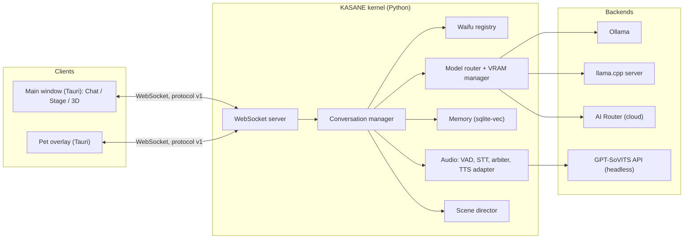
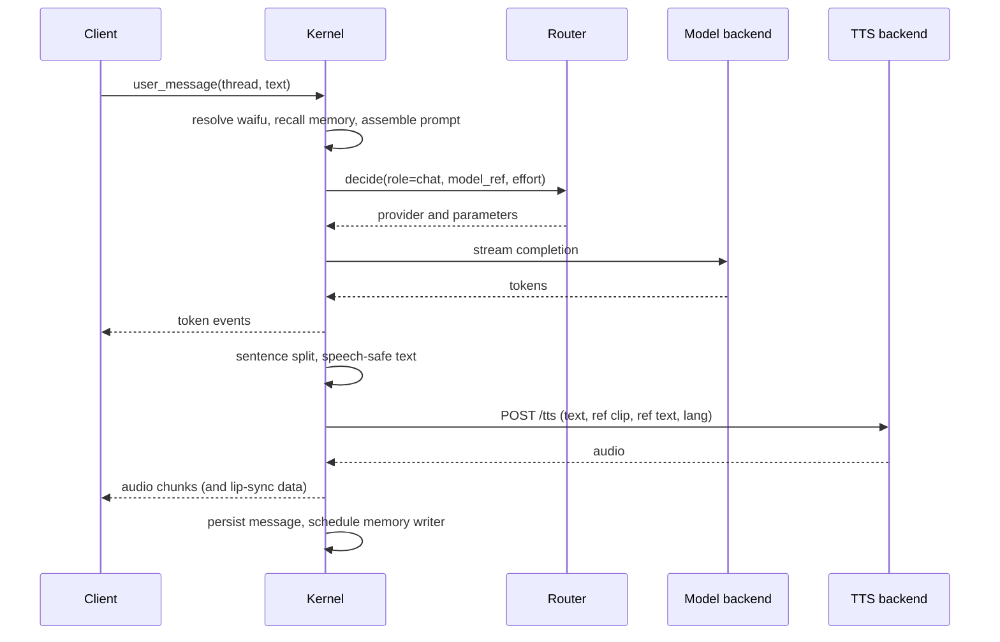
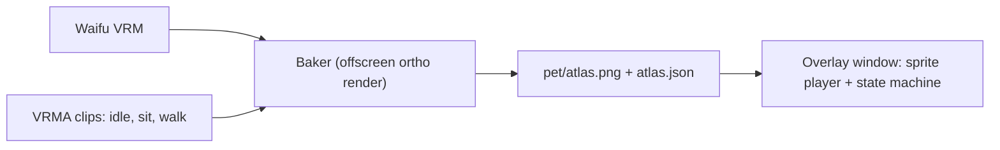

# ARCHITECTURE — Kōkyū

How the system is built. Requirements are in `SPEC.md`; rationale for choices is in `DECISIONS.md`. Where this document says **(draft)**, K0 must reconcile it with the real Yuri code before it is relied on.

## 1. Overview

One **kernel** (KASANE, Python) holds all logic and state. **Clients** (Tauri windows) render and send input. Heavy things (LLM runtimes, TTS) are **backends** the kernel talks to over HTTP. A waifu is *data* the kernel loads; no component contains waifu-specific code.



### Design principles

1. **Waifu = data.** Registry loads packs; the only waifu-dependent values are prompt text, TTS parameters, VRM and pet atlas (FR-W-3).
2. **Thin clients.** State lives in the kernel; clients subscribe to events and send intents. A browser tab, the Tauri window and the pet overlay are the same protocol.
3. **One door for models.** `router.decide()` (FR-R-1).
4. **VRAM is the scarce resource.** A manager owns what is loaded and refuses combinations that do not fit.
5. **Packaging-ready.** All paths from one module; no dev-only assumptions at runtime (RULES §9).

## 2. Processes and lifecycle

| Process | Owner | Started | Notes |
|---|---|---|---|
| Tauri main window | user | on launch | Chat, Stage, 3D views (Chat since K1; Yuri's widget window was deleted, D-062) |
| Pet overlay window | Tauri | when a pet is brought out | One per monitor (D-014) |
| Kernel (`KASANE/`, Python) | **Tauri** (child, Windows Job Object) | at launch, off the window's thread | `127.0.0.1:8780` (D-027) |
| TTS backend (GPT-SoVITS API) | kernel (child, inside the Job Object) | when the user turns voice mode on (D-061); stops `tts.idle_stop_s` after it goes off | Folder in `config.yaml` `tts.gpt_sovits.launch` (later Settings); outside this repo; default port 9880; log `logs/gpt_sovits.log` |
| `llama-server` | kernel (child) | only when the user picks a llama.cpp model or messages a thread that uses one (D-060) | Unloaded before an Ollama large model loads |
| Ollama | external service | by the user | The kernel only talks HTTP to it |

**Startup (D-060, superseding D-027's parallel start):** Tauri creates the window and, on another thread, clears a stale kernel listener and starts the kernel. The kernel opens its port at once and loads nothing heavy until the first window connects. Then, one at a time: the thread's chat model (Ollama or API only; a llama.cpp model waits to be picked), then the memory catch-up pass. The router reads its cached catalog at once. Voice (the TTS backend and the speech model) starts only when the user turns voice mode on (D-061). The code is `KASANE/boot.py`.

**Shutdown:** tray Quit → `POST /shutdown` to the kernel → every window's session closes and runs its memory pass (`/shutdown` waits for windows still closing, D-062) → kernel stops its children → hard kill after about 5 s. The Job Object (kill-on-close) guarantees no orphans if Tauri is killed.

**Health:** the kernel will expose a health endpoint (new) and publish `status` events that feed the Doctor panel (FR-SET-3).

## 3. Repository layout (target)

The kernel keeps Yuri's **flat module layout**: the `KASANE/` folder is put on `sys.path` and modules import each other by top-level name (`import llm`, `from audio import tts`). There is no importable `kasane` package (D-024).

```
KASANE/
  app.py                 the server only: routes, lifespan, entry point (D-062)
  session.py             one Session per window; a handler `on_<type>` per protocol message
  turns.py               one model turn: recall, prompt, router, stream, speech
  ambient.py             the screen companions' checks (Task Guide, OCR watch)
  companions.py          the window's active companion: persona and voice only
  boot.py                start-up order (D-060, D-061), stale-kernel takeover
  hub.py                 open windows, the driver, broadcasts, the shutdown event
  model_loader.py        one background loader for the chat model (D-054)
  bus.py  config.py  llm.py  check.py  context_budget.py  persona.py  shell_keys.py
  paths.py               DONE (K0): ALL filesystem locations
  waifus/                DONE (K0): pack model, loader, validator, registry (instruction template comes in K3)
  prompting.py           DONE (K0; K1c layers, D-074): persona + mode layer + scenario card + shared addendum + tool guidance
  threads/               NEW (K1): SQLite thread store
  conversation.py        NEW (K1): threads and history for a window (`get_manager()`)
  protocol/              NEW (K1): typed message models
  router/                from Yuri; K1 adds the `chat` role and the egress policy (D-025)
  models/                NEW (K1): backend lifecycle, VRAM manager, capability registry
  memory/                from Yuri; K0 adds the speaker
  audio/                 from Yuri; tts.py takes per-waifu voice parameters (K0-11)
  senses/  tools/        from Yuri (Task Guide and OCR watch parked, D-029)
  scenes/                NEW (K5): scene pack loader and director
  tests/  conftest.py
src/
  app/ React chrome · engine/ imperative three.js (Yuri's avatar code, for the K2 Stage) · net/ typed WebSocket client
src-tauri/               windows, tray, hotkeys, child processes, overlay hit-testing
config/                  config.example.yaml, models.example.yaml, secrets.example.yaml
scripts/                 dev.mjs, doctor.mjs, check.mjs (new), seed_waifus.py (new), packaging
tests-fe/
docs/
```

## 4. Kernel modules

| Module | Responsibility | Key invariants |
|---|---|---|
| `waifus/` | Parse/validate packs, hot-reload, expose `Waifu` objects | Pure data; no behaviour flags |
| `session.py`, `turns.py` | A window's messages (one `Session.on_<type>` each); a turn: resolve active waifu → recall memory → assemble prompt → call router → stream → speech pipeline → persist | Same code path for every waifu |
| `router/` | Role-based decisions, providers, spend, audit, redaction | Local-only roles refused for cloud before a provider is chosen |
| `models/` | Backend lifecycle (Ollama keep-alive, llama-server spawn), VRAM manager, capability registry | Only one big model resident at a time across backends |
| `memory/` | Facts and episodes with supersede and decay | Not namespaced by waifu; writes name the speaker |
| `audio/` | VAD, STT, TTS adapter, arbiter, speech-safe text | One voice at a time |
| `scenes/` | Load scene packs, place waifus, drive waypoints and gaze data | Produces *commands*; clients animate |

### 4.1 Prompt assembly

Yuri's real shape (`docs/notes/yuri-inventory.md` §5): `history[0]` is the system prompt (inferred), and one **ephemeral system message** (forget/task/look hints, recalled memory, scene context) is spliced just before the last user message and is never stored in history.

```
system    =  persona prompt (the speaking waifu's prompt: who she is, no format or length rules)
          +  MODE LAYER    (CHAT_LAYER or ROLEPLAY_LAYER, from the THREAD's mode; same for every waifu)
          [+ SCENARIO CARD (roleplay only: the filled-in card fields, its opening line last)]
          +  APP_ADDENDUM  (every mode: emotion tag, honesty about abilities)
          [+ TOOL_GUIDANCE (chat only: how to use the offered tools; roleplay offers none)]
history   =  prior messages (speaker-tagged; other waifus' lines appear as context)
ephemeral =  recall + hints + scene context [+ STORY so far in roleplay] [+ DELIVERY layer while voice is on]   (spliced before the last user message, as in Yuri)
user      =  current message (+ attachments)
```

Since D-074 (FR-MODE-2) the system message is built in layers by `prompting.build_system_prompt(persona, mode=, scenario=)`, reached through `companions.system_message(waifu, mode=, scenario=)`: the companion picks only the persona text, and `mode` and `scenario` come from the thread (`conversation.prompt_layers(thread)`), never from a companion. Parts are joined by a blank line; the addendum and the tool guidance share one paragraph. `Session.system_prompt()` is the one builder for every place `history[0]` is set (window open, thread load, Regenerate and its failed-reply restore, the companion switch through `apply_switch(..., mode=, scenario=)`), and `boot.warm_up_prompt()` builds the llama.cpp warm-up from the same function for the last thread, with that mode's tool list (none in roleplay), so the cached prefix matches the first turn. The system message is stable for the life of a thread; what changes per turn (recall, hints, the story summary, the voice delivery layer) belongs in the ephemeral note, so llama-server's cached prefix holds.

The **app addendum** is the same for all waifus and modes and carries the **emotion-tag convention** (the reply ends with `[happy|angry|sad|teasing|surprised|neutral]`, extracted by the existing helper) and a no-capability-claims line; the generic output cleanup (`apply_persona_pass`) runs on spoken text. Only the persona differs between waifus. The invariance test (FR-W-3) diffs everything *except* the persona prompt and TTS parameters, in a chat thread and in a roleplay thread.

A turn (`turns.run_turn(..., mode=)`, the mode from `Session.thread_mode()`) differs by mode only in what it reads, runs and offers (K1c-03, FR-MODE-3, 4, 8): in **roleplay** there is no `forget`, no Task Guide classification or idle-clock touch and no look intent, recall is the profile card alone (`recall.build_profile_context`, framed as the real person and not their role), no tools are offered, and the exchange is not written to `transcript_log`; Temp Chat reads nothing in either mode. The router role is `chat` in both. `tools.dispatch_tool_call(..., offered=)` refuses any tool the turn did not offer, which also stops an API model from running a local-only tool it was never given. While voice is on, the mode's DELIVERY text joins the ephemeral note. History, the saved message and `turn_done.text` are the raw streamed text minus the trailing emotion tag (Markdown and paragraphs survive); the clause chunks are the speech side only. In **roleplay** the raw stream first goes through `speech.DialogueFilter` (K1c-05, FR-MODE-8), a streaming cut that drops `*actions*`, `(OOC ...)`, `((...))` and `[...]` and, once the reply has used a double quote, all unquoted narration; the chunker, the voice and the captions (`speak.text`) see only what is left, so only her dialogue is spoken and captioned. The emotion is read from the raw text, and the chunker holds back a trailing `[word]` until the stream ends, so the tag is never spoken in either mode. Both screen-companion loops skip while a roleplay thread is open (FR-MODE-9).

**Story memory** (K1c-04, FR-MODE-5) is `KASANE/story.py`. Each roleplay thread has one `story_memory` row in `threads.db` (schema 4, deleted with its thread) holding a running summary and `through_message_id`, the last message folded into it. `story.KEEPER` folds the older lines into the summary with the local `memory_writer` role (D-015): only once `story.summarize_every` lines are waiting, never the newest `story.keep_recent` (at least 2, so Regenerate never touches summarized text), long backlogs in several calls, the result cut at a sentence end within `story.max_chars`. It runs in the background after a roleplay exchange is saved and when a roleplay thread that is behind is opened, one pass per thread, only while the arbiter is idle, and `run_turn` cancels it at turn start beside the memory writer's `preempt`. A failure is logged and keeps the old summary. The session caches the open thread's summary (the keeper tells every window when it changes), and `start_turn` passes it as `run_turn(..., story=)`, which adds `prompting.STORY_NOTE` to the ephemeral note before the delivery text. Temp Chat and chat threads have no story memory and get no note; nothing from it reaches `memory.db`.

### 4.2 Turn lifecycle



## 5. Protocol

WebSocket at `ws://127.0.0.1:8780/ws` (Yuri used 8765). **Since D-062 the window speaks v1 only (§5.3);** a flat message gets `bad_message`. §5.1 to §5.2b record Yuri's untyped messages (`docs/notes/yuri-inventory.md` §4) for history; they are retired.

### 5.1 Existing messages (kept)

| Direction | Types |
|---|---|
| Client → kernel | `user_text`, `user_file`, `user_audio`, `audio_frame`, `audio_end`, `stop`, `set_temp_mode`, `set_ocr_watch`, `set_api_model`, `get_log`, `clear_log`, `camera_frame`, `scene_state` |
| Kernel → client | `speak` (`text`, `audio_b64`, `mime`; one per clause), `turn_end`, `transcript`, `speech_state`, `surface_status`, `settings`, `log`, `barge_in`, `request_camera_frame` |

There are **no token events** and no thread, waifu or model concept.

### 5.2 Added in K0

| Direction | Type | Purpose |
|---|---|---|
| Client → kernel | `switch_waifu` `{id}` | Change the active waifu for subsequent turns |
| Kernel → client | `waifu_state` `{active, waifus:[{id, name, premade, traits}], problems:[text], pending?}` | Roster and active waifu; sent on connect and after every switch. `active` is null when no pack is installed; `pending` names a switch waiting for the running turn |
| Kernel → client | `error` `{code:"unknown_waifu", message}` | A switch named a companion that does not exist |
| Kernel → client | `speak` with `audio_b64: ""` | Voice backend down: caption only, no audio (FR-V-7) |
| HTTP | `GET /waifus/{id}/vrm` | A registered waifu's avatar (CORS: loopback page origins, GET only) |

### 5.2b Added in K1-00 (threads; untyped until K1-00b)

| Direction | Type | Purpose |
|---|---|---|
| Kernel → client | `thread_opened` `{thread, messages}` | Sent on connect (the last opened thread, else the newest, else a new one) and after every open/new/delete |
| Kernel → client | `thread_list` `{query, threads}` | Sidebar history, newest first; sent on open and after every saved exchange, rename or delete |
| Kernel → client | `thread_message` `{thread, message}` | A divider written when the companion changes (FR-S-2) |
| Client → kernel | `thread_list`, `thread_search {query}` | History list, or threads whose title or messages contain the text |
| Client → kernel | `thread_new {mode?, scenario?}`, `thread_open {id}`, `thread_delete {id}` | Change the open thread; refused with `error {code:"turn_running"}` while a reply runs. `thread_new`: `mode` is `chat` (default; `{}` stays valid) or `roleplay`, fixed for the thread's life (FR-MODE-1); `scenario` is the roleplay's card (`title` up to 120 characters, `setting`, `user_role`, `her_role`, `rules` up to 2000, `opening` up to 4000; all optional, no other keys), kept only for a roleplay, only its filled-in fields; a card title names the thread. The new thread keeps the open one's model and effort, not its Temp Chat flag. Thread rows (`thread_opened`, `thread_list`, `thread_updated`) carry `mode` and `scenario` |
| Client → kernel | `thread_rename {id, title}` | Rename; `error {code:"unknown_thread"}` for a missing id |

`KASANE/threads/store.py` owns `threads.db` (SPEC §3.5 plus a `temp` column for FR-MEM-5, `efforts` for FR-M-11, `mode` and `scenario` for FR-MODE-1 (schema 3, added in place: older threads read as chat), a `story_memory` table for FR-MODE-5 (schema 4), and a small `kv` table for the last opened thread); `KASANE/conversation.py` turns stored messages into the turn's history (dividers excluded) and records each exchange with speaker, model ref, effort and a `stopped` flag. `_run_turn` gained one optional `on_finished(user, reply, stopped)` callback and still never sees a waifu. Opening a thread brings back its companion; `set_temp_mode` is saved on the thread.

### 5.3 Target (K1): typed protocol

Pydantic models in `KASANE/protocol/`, mirrored in `src/net/`; frames `{ "v": 1, "type", "id", "thread", "data" }`; a version mismatch is a hard, visible error. Additions beyond 5.1/5.2:

| Direction | Type | Purpose |
|---|---|---|
| C→K | `hello` | Client identity (main, pet), protocol version |
| C→K | `set_model`, `set_effort` | Per-thread selection |
| C→K | `model_list`, `model_load` | Picker contents; *Try again* after a failed load |
| C→K | `attach` | Register an uploaded file or camera frame |
| C→K | `scene_enter`, `scene_set`, `scene_leave`, `scene_input` | 3D mode (K5) |
| C→K | `pet_spawn`, `pet_dismiss`, `pet_click` | Pets (K4) |
| C→K | `waifu_create`, `waifu_delete`, `waifu_validate_*` | Creator (K3) |
| K→C | `state` | Thread, waifu, model, effort, voice-status snapshot |
| K→C | `turn_start`, `token` | Streaming (FR-C-2) |
| K→C | `captions`, `expression`, `look_at` | Avatar hints |
| K→C | `model_list`, `model_status`, `vram` | Model chip, picker (with the spend footer), loading state |
| K→C | `error` | Typed errors (quota, auth, vram, tts_down, …) |
| K→C | `scene_state` | Positions, anchors, who is speaking |
| K→C | `doctor` | Health report |

Binary frames carry audio when `speak` is replaced by chunked audio (K2).

**Built in K1-00b (D-049):** the envelope, `hello` (version handshake), the thread messages of §5.2b as frames, `turn_start` / `token` / `turn_done`, and `error {code, message, reply_to}` with the codes in `KASANE/protocol/__init__.py`. The rest of the table above lands with the features that need it. **K1-00c (D-050):** `set_model {model_ref|null}` and `set_effort {effort|null}` (validated; answered with `thread_updated {thread}`); `error` frames with `code: model_blocked | model_failed`, `reason`, `model_ref` and `actions` for FR-R-5. **K1-10 (D-054):** `model_list {refresh}` → `model_list {default_ref, local, api, …, spend}`; `model_status {model_ref, label, state, message, elapsed_s}` to every window on connect and on each change; `model_load` (driver only); `hello` answers with `default_model_ref` and `default_effort`.

## 6. Data and storage

### 6.1 App-data layout (via `paths.py`)

Dev: `./data`. Packaged: `%APPDATA%\Kokyu`.

```
data/
  settings.json
  threads.db            threads, messages, attachments
  memory.db             Yuri memory v2 schema
  waifus/<id>/          waifu.yaml, prompt.md, model.vrm, voice/ref.wav, pet/
  scenes/<id>/          user-added scenes (built-in scenes ship with the app)
  attachments/
  logs/                 kernel.log, tts.log, audit.jsonl, latency.jsonl
  cache/                model catalog, thumbnails
  spend.db
```

### 6.2 Config layering

`defaults (code)` → `config/config.yaml` (dev) → environment (`KOKYU_*`, `.env`) → `settings.json` (user changes in the UI). Later layers win. Secrets come only from `.env` or `config/secrets.local.yaml`.

### 6.3 Writes

Atomic (temp file then rename) for settings and packs; SQLite in WAL mode; waifu pack creation is staged in a temp directory and moved into place only when valid.

## 7. Model routing and the VRAM manager

### 7.1 Roles

Yuri's roles are kept (`docs/notes/yuri-inventory.md` §6): `reflex`, `vision`, `classifier`, `embed` and `memory_writer` are `local_only` (a startup invariant); `mind` is the only cloud-eligible role and nothing calls it yet. Kōkyū adds a **`chat`** role in K1 that runs on the thread's user-selected `model_ref`, local or API; the selection is the consent (D-025). Until K1, chat turns keep using `reflex`.

| Role | Used for | Where it may run |
|---|---|---|
| `chat` (K1) | The user-selected model for the thread | local or API |
| `reflex` | Yuri's current chat role (until K1) | local only |
| `mind` | Yuri's cloud-eligible role; unused until agent mode | local or API |
| `classifier` | Speaker choice (two-waifu scenes), look-intent | local only |
| `memory_writer` | Distilling facts and episodes | local only |
| `embed` | Memory recall (`nomic-embed-text`) | local only |
| `vision` | Camera and image attach | local by default; API only for images the user explicitly attached (D-025) |

### 7.2 Capability registry

`config/models.yaml` (plus catalog flags for API models) declares per model: supported effort levels and mapping, context size, vision support, and an optional VRAM estimate override. This is how the effort slider knows its detents (FR-M-10).

### 7.3 VRAM manager

- Reads total/free VRAM through NVML, straight from the driver's `nvml.dll` (ctypes, no package), else `nvidia-smi` (D-065). `KASANE/vram.py`.
- Estimates a model's footprint as file size plus KV cache plus a safety margin; **measured** values observed after load replace the estimate and are cached.
- Tracks residents: chat model, embeddings, TTS backend, renderer allowance.
- Rule: only **one large LLM** resident across Ollama and llama.cpp. Selecting a model on the other backend unloads the first (`keep_alive: 0` for Ollama; stop `llama-server`) before loading. "Large" means its measured VRAM: a MoE with experts on the CPU (about 3 GB) may stay resident beside the small helpers (classifier, embeddings). Starting `llama-server` unloads Ollama's models except the small helpers (D-052), and picking an Ollama chat model stops `llama-server` first (D-054). Before either, the load check (`router/listing.py` `load_check`) refuses a model that would not fit beside the helpers once the other chat model is gone (D-065).
- Produces *fits / won't fit* hints for the switcher and refuses a load that would exceed free VRAM minus headroom, naming the blocker.
- Large MoE on llama.cpp (Qwen3.6-35B-A3B Q4) keeps every expert in system RAM (`--n-cpu-moe 40`): about 3 GB VRAM, about 19.5 GB working set (memory-mapped, so the OS can page it), about 4.6 GB private. Measured numbers and the settings that won: `docs/STATE.md` (K1-01).

### 7.4 Providers

`ollama` (native API), `llamacpp` (OpenAI-compatible) and a generic **`openai_compat`** provider (configurable base URL and key; AI Router, OpenRouter, DeepSeek and others are presets; Yuri's `airouter` provider is the starting point, D-037). The provider is chosen only by `decide()`. User-selected API failures are surfaced, never rerouted (FR-R-5). `llm.py` takes a model and a `think` override per call (K1-00c), and the Ollama provider always passes the model the router chose, for every role (D-052); helper models set to null mean the reflex model. The **model loader** (`KASANE/model_loader.py`, D-054) loads the chat model in the background, one load at a time, newest request wins: at boot the last thread's model (else `chat.default_model_ref`), on a pick in the model chip, on opening a thread with another model (after `chat.load_delay_s`), and on *Try again*. Every state change goes to every window as a `model_status` frame; the chat shows it as the "waking up" card. A llama.cpp load also reads the persona once and warms the helpers (D-052). `router/listing.py` builds the picker's `model_list` (presets, Ollama `/api/tags` minus embedding models, the API catalog, spend). The `llamacpp` provider (`router/providers/llamacpp.py`) owns one `llama-server` child per preset (`config.yaml` `llamacpp.presets`, D-054), started on first use and stopped at shutdown; it reuses the OpenAI streaming code and moves per-turn system notes into the next user message so the server's prompt cache keeps hitting (D-051).

## 8. Voice pipeline

```
mic frames → VAD (energy) → STT (faster-whisper, CPU) → transcript → user_message
model tokens → sentence splitter → speech-safe normalizer → TTS adapter → audio chunks → arbiter → client playback → lip-sync
```

- **Voice providers** share one interface, `synthesize(text, voice) → audio` (D-036): `gpt_sovits`, `builtin` (small local voices; chosen in a K2 spike) and `elevenlabs` (hosted, opt-in, badged as cloud). The **`gpt_sovits` adapter** (`audio/tts.py`) speaks only the contract in `TTS-BACKEND.md`. Per request: `text`, `text_lang`, `ref_audio_path`, `prompt_text`, `prompt_lang`. It sends a **pre-warm** on waifu select. If the backend is down it raises a typed error; the conversation continues text-only.
- **Arbiter** owns the single audio output: states `idle`, `speaking`, `cancelling`. A new user speech event while `speaking` triggers barge-in: cancel generation, drop queued lines, send `stop_playback`.
- **Lip-sync** is computed on the client from the audio being played (amplitude to `aa`), so it stays in sync with real playback.
- STT stays on **CPU** by default (VRAM budget, and the known CUDA DLL issue on this machine).

## 9. Clients

### 9.1 Main window

Yuri's UI was a **stage-first widget** (340×480 borderless, transparent, always-on-top window; inventory §11–12). K1 replaced it with the normal app window and deleted it (D-062); its avatar code is in `src/engine/` for the Stage view in K2.

React renders chrome: sidebar, thread view, input row, popovers, settings, creator. **Since K1-02** (D-053) `index.html` is this window (`src/app/`: `chat-state.ts` pure reducer, `store.ts`, `ui/`; `src/net/kernel.ts` socket). A **store** (default Zustand, D-013) is fed by WebSocket events. The **engine** (`src/engine/`) is an imperative three.js module mounted into a canvas ref; React never drives per-frame state.

Views of one thread: **Chat**, **Stage**, **3D**. All three read the same store.

### 9.2 Engine (shared by stage, pets baker and 3D)

- Avatar loader: `GLTFLoader` + `VRMLoaderPlugin`, `VRMUtils.rotateVRM0()`, bone and expression discovery, spring bones.
- Stage: auto-framing from head/chest bones, backdrop, idle motion, lip-sync, look-at.
- Scene runtime: scene pack loader, WASD controller with pointer lock, colliders, waifu placement from `scene_state`.
- XR-compatible renderer setup (no XR code in v1).

### 9.3 Pets



- **Baker** runs in the main window's engine on waifu save (and on demand), writing the atlas to `pet/`.
- **Overlay** is one transparent always-on-top window per monitor hosting all pets on a canvas. Rust handles window flags and **alpha hit-testing**: it toggles cursor pass-through depending on whether the pointer is over an opaque sprite pixel (the overlay reports hit-test data; Rust applies `ignore cursor events`). K4 starts with a spike to validate this against one-window-per-pet.
- Sprites animate at 12 to 24 fps; no 3D at runtime.

### 9.4 3D scenes

Scene pack (`scene.glb` + `scene.yaml`) loaded by the engine. The kernel's **scene director** decides where each waifu is, which anchor she uses and her waypoints, and emits `scene_state`; the client animates with the shared avatar code. Collision is simple boxes from `colliders`. The user's controller is client-side; position is reported to the kernel so waifus can face and approach.

## 10. Security and trust

- Kernel binds to loopback; Tauri CSP forbids remote scripts.
- Bus events carry `trust` (`trusted` from the user, `untrusted` from files, OCR, web). Untrusted text is data, never an instruction source. This is groundwork for agent mode.
- Redaction (keys, paths, emails, long digit runs) applies before any cloud call and in the audit log.
- End-user keys live in the **Windows Credential Manager** (set through the app; the Rust shell passes them to the kernel at spawn). `.env` and `secrets.local.yaml` are developer-only; the repo carries `.example` files.

## 11. Packaging architecture (K7, designed now)

- **Installer:** Tauri bundler produces an NSIS installer (Yuri already sets the `nsis` target); the WebView2 bootstrapper is included. `security.csp` is currently `null` in the seeded config and must be locked down in K1.
- **Kernel sidecar:** the Python kernel is frozen (PyInstaller or an embedded Python) and registered as a Tauri sidecar; the Job Object logic is unchanged.
- **Not bundled:** model weights, Ollama, the GPT-SoVITS backend. A **first-run checklist** (the Doctor panel) detects each and links to instructions.
- **Portable bundle:** zip containing the app, `setup.ps1` (creates the Python environment if the sidecar is not frozen, verifies prerequisites, runs the Doctor) and a README with setup instructions.
- **Data:** `%APPDATA%\Kokyu` (FR-DIST-4). Built-in scenes and the instruction template ship as read-only resources.
- Design consequences already enforced: `paths.py`, no repo-relative assumptions, config layering, versioned protocol, bundled resources accessed through a resource resolver.

### 11.1 Packaging decisions for the K1b spike

1. **Kernel packaging.** (a) PyInstaller one-folder build shipped as app resources and launched by the shell, or (b) an embedded CPython with prebuilt site-packages. The user installs neither Python nor Node in either case. Choose by installer size, antivirus behaviour (unsigned PyInstaller executables are a known false-positive trigger) and updateability. Tauri's `externalBin` expects one executable, so a one-folder build needs resource bundling.
2. **Installer.** NSIS, per-user (no admin), with the WebView2 bootstrapper; MSI only if a channel needs it.
3. **Updater.** Tauri updater with its own signing key (separate from the code-signing certificate); a static update manifest.
4. **Code signing.** Research certificate options and eligibility; sign the installer and the kernel executable. Expect SmartScreen friction for a new publisher.
5. **License key.** A public key compiled into the app verifies a signed key offline; storage in app data (FR-DIST-10, depends on D-032).
6. **Diagnostics.** Export zip: redacted logs, versions, component states (FR-DIST-8).
7. **CI.** GitHub Actions on tagged releases builds the installer on a Windows runner; the clean-VM install test is manual until automated.

## 12. Testing architecture

| Layer | Tool | Notes |
|---|---|---|
| Kernel unit and integration | pytest | Fakes for models, TTS, STT; real SQLite for memory/threads |
| Invariance tests | pytest, parameterized over fixture waifus | FR-W-3 |
| Protocol contract | pytest + shared JSON fixtures also used by frontend tests | Prevents drift |
| Frontend | the runner Yuri uses (`npm run test:fe`) | Store reducers, components |
| Type/build | `tsc --noEmit`, `vite build`, `cargo check` | `npm run check` |
| Manual gates | checklists in `TODO.md` | Anything needing GPU, mic, display or VR |

No automated test may require a GPU, network, API key or display.

## 13. Performance budget (planning numbers, to be measured)

| Component | Approx. VRAM | Notes |
|---|---|---|
| Chat model `qwen3.5:9b` Q4 | ~6.6 GB | Q6_K_L (~9.4 GB) is opt-in |
| `qwen3.5:4b` | ~3.4 GB | "Lite" |
| Embeddings | ~0.3 GB | Always resident |
| GPT-SoVITS | ~2 to 3 GB (unmeasured) | Measure in track T |
| Renderer | ~0.5 to 1 GB (unmeasured) | Measure in K2 |
| Qwen3.6-35B-A3B Q4 (llama.cpp, all experts on CPU) | ~3 GB | ~19.5 GB system RAM mapped, ~4.6 GB private (K1-01, measured) |

## 14. Extension points for deferred features

- **Agent mode** adds a `tools/` package and a `read/write` tier system behind the existing router and bus; the thread gains a `mode` field; no waifu-facing changes. The `trust` flag already exists.
- **VR** adds an XR session to the engine's renderer and a client route served by the kernel; the protocol and scene runtime are unchanged.

## 15. Component manager and first-run

Every managed piece of infrastructure is a **component** with one interface, so the Doctor panel, the Welcome wizard and the repair buttons share the same code (FR-COMP, D-035).

| Component | Kind | How it is managed |
|---|---|---|
| Ollama | external service | Detect (port 11434, installed), install by running the official installer with the user's consent (silent mode to be tested), monitored only; model pulls through the Ollama API with progress |
| llama.cpp server | downloadable binary | Download a pinned release (CPU or CUDA variant chosen by the hardware check), verify our SHA-256, start on demand as a kernel child |
| GPT-SoVITS backend | downloadable package | Recipe from Track T (official Windows package or a scripted install), pinned version and hash, started by the shell as a child; advanced and hardware-gated |
| STT model | model files | faster-whisper downloads the chosen size on first use; the app shows progress |
| Built-in voice | model files | Small local voice model, chosen in K2 |
| Hosted providers | none | Key test only |

**Interface:** `detect() → {state, version, location}`, `install(progress)`, `start()`, `stop()`, `health() → {ok, code, message, fix}`, `repair()`. **States:** `missing`, `installing`, `stopped`, `starting`, `running`, `unhealthy`.

**Manifest:** `components/<id>.json` ships with the app: id, version, source URLs, SHA-256, size, install steps, start command, health URL, hardware requirements. Track T delivers the GPT-SoVITS one.

**Rules:** installs are user-initiated, resumable, cancellable, write only under the app-data directory and verify hashes; started components are Job Object children; externally managed ones are only monitored; every failure maps to a plain message with one primary action.

**Wizard:** a state machine persisted in `settings.json` (`onboarding.step`, `completed`); skippable steps; re-runnable from Settings; the API path finishes with nothing installed except the built-in voice. **Doctor:** the same component states as a panel.
